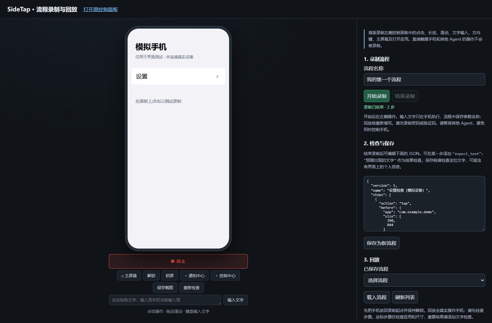

# iPhone Flow

**Record iPhone actions on Windows. Replay them with checks. See where a flow failed.**

[简体中文](README.zh-CN.md) · [Setup](docs/INSTALL.md) · [Workflow format](docs/WORKFLOWS.md) · [Limitations](docs/LIMITATIONS.md) · [Changelog](CHANGELOG.md)


iPhone Flow is a Windows-first, local workflow recorder built on [SideTap](https://github.com/ucsandman/SideTap). Use the browser control panel to operate a connected iPhone, save the supported actions as JSON, provide fresh text parameters, and replay the flow with step reports and screenshots.

**Preview release.** The inherited control stack was previously exercised on one iPhone 14 Pro running iOS 26.4. The new recorder and replay feature has been verified with simulated devices and browser integration, **not yet end-to-end on a real iPhone**. The UI is currently primarily Simplified Chinese. See the [validation record](docs/VALIDATION.md).



*The screenshot above uses a simulated phone. It is a UI preview, not evidence of a real-device replay.*

## What you can do

- **Record supported panel actions:** taps, long presses, swipes, typing, backspace/arrow keys, Home, and opening an app.
- **Save inspectable workflows:** plain JSON, with no generated Python or JavaScript to execute.
- **Reuse text as parameters:** recording executes your text on the phone but saves a parameter name in the workflow. Fill the values again for each replay.
- **Locate controls by visible text and type:** a unique recorded element is resolved again before tapping. Missing or ambiguous elements stop the flow; they do not silently fall back to stale coordinates.
- **Check the execution context:** lock state, foreground app, and screen size are checked before each step. Add `expect_text` to check visible, non-editable UI text after an action.
- **Inspect failures:** per-step results, available screenshots, and a local JSON report. A timed-out action is never automatically replayed.

This first version records actions sent through the control panel. It does **not** record direct finger touches on the phone or actions from other Agent/MCP processes.

## Quick start

You need **Windows 10/11, Python 3.12, Apple USB drivers, go-ios, and a signed, installed WebDriverAgent**. Your iPhone must be connected by USB and unlocked. Installing the Python dependencies alone does not complete phone setup.

```powershell
git clone https://github.com/Au-sky237/iphone-flow.git
cd iphone-flow
py -3.12 -m venv .venv
.\.venv\Scripts\python.exe -m pip install -r requirements.txt

# Complete the phone/driver setup in docs/INSTALL.md first.
.\.venv\Scripts\python.exe launch.py --flows
```

The workbench opens at **http://127.0.0.1:8770/flows**. After setup, you can also double-click `iphone-flow.cmd`. Use `python launch.py` for the full inherited SideTap control panel.

[Read the Windows setup guide →](docs/INSTALL.md)

## Record → inspect → replay

1. Pause other phone controllers and put the iPhone at the starting screen.
2. Name the flow and start recording. Operate the phone through the panel.
3. Stop recording. Inspect the JSON, add result assertions where useful, and save.
4. Return the phone to the same starting screen. Select and load the saved flow.
5. Fill its input parameters and start replay. Inspect the report and screenshots.

The compact workbench shows the phone controls. To record opening an app, use the link to the full panel; both pages use the same recording session. Continuous keyboard typing may be split into multiple parameters; pasting a complete text fragment is easier for this preview.

**A passed step is not a guarantee that a business operation succeeded.** Without `expect_text`, it only establishes that the device call returned and the foreground-app check passed. Coordinate-only steps cannot prove that the screen contents match the recording.

## A workflow is a file you can read

```json
{
  "version": 1,
  "name": "Open Settings — 393 x 852 point example",
  "steps": [
    {
      "action": "open_app",
      "before": { "app": "com.apple.springboard", "size": [393, 852] },
      "args": { "bundle": "com.apple.Preferences" },
      "after_app": "com.apple.Preferences"
    }
  ]
}
```

This example requires an unlocked phone on the Home Screen with the stated point dimensions. Record your own workflow for your device. See [examples](examples/) and the [format reference](docs/WORKFLOWS.md).

## Boundaries worth knowing

| Area | Current behavior |
| --- | --- |
| Recording | Panel requests only; no direct-touch capture or cross-process recording |
| Typing | Input values are not written into workflow/report JSON; they are still sent to the phone |
| Result checks | App/context checks and optional visible-text assertions; no general visual comparison |
| Coordinates | Same point dimensions required; no cross-device scaling |
| Cancellation | Takes effect between device calls; cannot undo an action already submitted |
| Retries | No automatic action retry after a timeout |
| Startup | Existing SideTap link setup and diagnostics; WDA signing is still required |
| Concurrency | Other panel actions are blocked during replay; external controllers/direct touches are not |
| Restart | Saved flows/reports persist; the unsaved recording draft does not |
| Language | Primarily Simplified Chinese UI; English and Chinese documentation |

Screenshots, element labels, and hand-written assertions can contain private information. They are stored locally without an added encryption layer. Review files before sharing. Do not record passwords, verification codes, or unlock sequences. See [limitations](docs/LIMITATIONS.md) and [security notes](SECURITY.md).

## Development and tests

```powershell
.\.venv\Scripts\python.exe -m pip install pytest
$env:PYTEST_DISABLE_PLUGIN_AUTOLOAD = '1'
.\.venv\Scripts\python.exe -m pytest tests -q
```

Tests use fake devices and local HTTP servers; they do not require a phone. The initial development checkout contained 595 collected tests, including 37 new workflow tests. Detailed results and the real-device gap are recorded in [VALIDATION.md](docs/VALIDATION.md). CI runs the suite on Windows/Python 3.12.

## Attribution and license

iPhone Flow is an independent derivative of **SideTap by Wes Sander**, not an official SideTap release. The original MIT license is preserved. The source baseline and changes are recorded in [NOTICE.md](NOTICE.md) and [UPSTREAM.json](UPSTREAM.json).

The Windows/USB control stack comes from SideTap, [go-ios](https://github.com/danielpaulus/go-ios), and [WebDriverAgent](https://github.com/appium/WebDriverAgent). SideTap credits [phone-harness](https://github.com/ShawnPana/phone-harness) for its original macOS concept. The recorder interaction was informed by [Appium Inspector](https://github.com/appium/appium-inspector); this project does not require an Appium Server.

The new contribution is the local recording/replay workbench, JSON workflow checks and reports, parameterized input handling, Chinese interface adjustments, and local connection changes. Upstream features should not be mistaken for new work in this repository.

Contributions are welcome: start with the [contributing guide](CONTRIBUTING.md), especially real-device validation and reproducible failures. [MIT](LICENSE).
